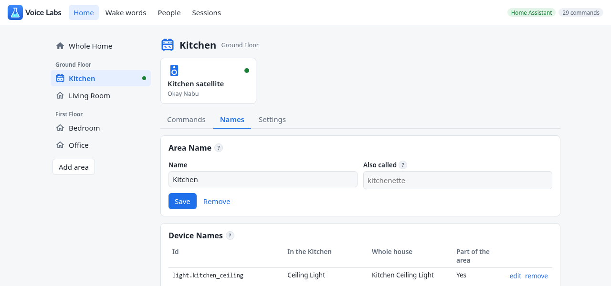

> [!WARNING]
> Voice Labs is experimental and not supported.

<picture>
  <source media="(prefers-color-scheme: dark)" srcset="voice_labs/web/logo-dark.svg">
  
</picture>

Voice satellites with commands you make yourself, recognized on your own Home
Assistant. A command says what to listen for, where, and what happens: speak a
response, run a script, activate a scene, or run an action. It hears and
speaks English.


## Highlights

- **Commands you make yourself.** Start from the library -- lights, timers
  and alarms, music, weather, climate, covers and locks, lists, reminders,
  announcements and intercom -- or from scratch. A library command keeps
  following the library as it gets better, with your changes on top.
- **Heard on your own machine.** Commands are recognized in the audio
  itself, against the names of your areas and devices -- and the ones you
  give them on the Names page.



- **Most of the work happens while you're still talking.** The wake word is
  checked again and the speaker recognized as you speak; when you stop, it
  acts and answers.
- **Wake words, checked twice.** The satellite listens generously, and
  every wake word it hears is checked again against phrases that sound like
  it ("hey travis", "hey microsoft"). Okay Nabu, Hey Jarvis and Hey Mycroft
  are built in; upload your own, or train one in the app. Up to five per
  satellite.
- **Something sensible when nothing matches.** Skills answer exactly
  ("what's twelve times eight"), the commands you choose are found by what
  you meant ("kill the lights in the office", "give me ten minutes for the
  pasta"), questions go to your conversation agent, and otherwise it says the
  closest command and what was missing.
- **It knows who's speaking.** Enroll voices on the People page, and "add
  call mom to my to-do list", "remind me" and "play my playlist" are the
  speaker's own.
- **By area.** A command is the whole home's or one area's, and the whole
  home's can be turned off where they don't belong ("That command isn't
  available in the Kitchen"). Do not disturb and night mode, area by area.
- **Conversations, not just commands.** A command can ask before it acts,
  and "it" is what you just named.
- **Timers and alarms** ring on the satellite that set them.


- **Every session, step by step.** What was heard, what ran and what was
  said, with how long each step took. Replay a session, or type a sentence to
  see what it would do.
- **Home Assistant's voice assistants too.** The app's speech-to-text,
  text-to-speech and conversation agent are a Wyoming service, for satellites
  that aren't its own and for what's typed in Assist.

## Install

You need Home Assistant 2025.10 or later, on amd64 or aarch64, and a
[Home Assistant Voice Preview Edition](https://www.home-assistant.io/voice-pe/)
to flash.

1. **The app.**
   [](https://my.home-assistant.io/redirect/supervisor_add_addon_repository/?repository_url=https%3A%2F%2Fgithub.com%2FOHF-Voice%2Fapps-experimental)
   Add `https://github.com/OHF-Voice/apps-experimental` to Home Assistant's app
   repositories, then install **Voice Labs** and start it. The first time it
   starts, it downloads its speech models -- about 530 MB: Parakeet (speech),
   EmbeddingGemma 2 (meaning), GLiNER (the command fallback) and Piper's
   Kristin (its voice) -- into its own storage, and its page shows how far it
   got. Later starts and updates keep them.
2. **The integration.**
   [](https://my.home-assistant.io/redirect/hacs_repository/?owner=OHF-Voice&repository=voice-labs&category=integration)
   In [HACS](https://hacs.xyz), add `https://github.com/OHF-Voice/voice-labs`
   as a custom repository of type **Integration**, download **Voice Labs**,
   and restart Home Assistant. The app sets it up the next time it connects.
   It gives each satellite a device and its timers, and runs Assist's intents
   for the app.
3. **The satellites.** Flash a Home Assistant Voice Preview Edition with the
   Voice Labs firmware from its
   [install page](https://ohf-voice.github.io/voice-pe-alt-firmware/voice-pe-voice-labs/)
   and give it your Wi-Fi. The app finds it on the network and connects to it.

Then open **Voice Labs** in Home Assistant's sidebar to make commands, name
things, set up satellites and look at sessions. The
[guide](https://github.com/OHF-Voice/voice-labs) has everything it does, page
by page.

### Standalone

Without Home Assistant's app store, it runs as a container:
`ghcr.io/ohf-voice/voice-labs` (amd64 and aarch64), given Home Assistant's
address and a long-lived access token. It has no wake word training.

```bash
docker run -d --name voice-labs --network host \
  -e HASS_URL=http://homeassistant.local:8123 -e HASS_TOKEN=... \
  -v voice-labs:/data ghcr.io/ohf-voice/voice-labs
```

The web UI (8099) and Wyoming (10800) listen on every address the container
has, and neither asks who's there: anyone who can reach the web UI can run
actions in Home Assistant. Without the host network, publish what you want
reached, and where (`-p 127.0.0.1:8099:8099 -p 10800:10800`). Wyoming needs
nothing more -- add it to Home Assistant as a Wyoming Protocol integration --
but finding the satellites does: they're found by mDNS, which a container's
own network doesn't carry (`--host` reaches one without it). More options go
after the image name.

### From source

See [Running from source](DESIGN.md#running-from-source) in the design notes.

## More

- [The guide](https://github.com/OHF-Voice/voice-labs): everything the app
  does, page by page.
- [DESIGN.md](DESIGN.md): how it works, what was measured to get it there,
  and how to work on it.
- [CHANGELOG.md](CHANGELOG.md): what changed, version by version.
